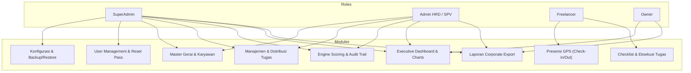
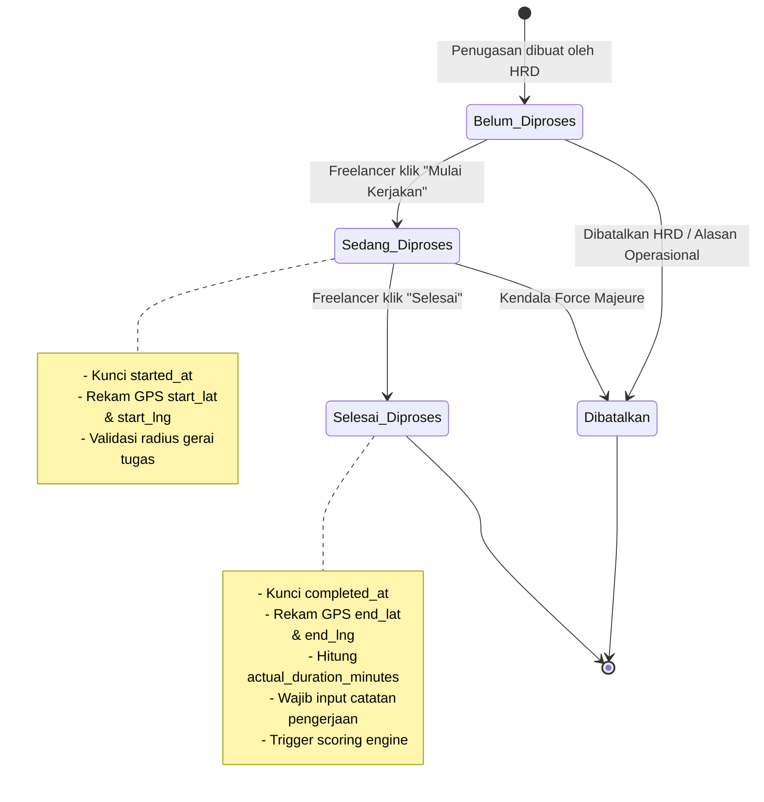
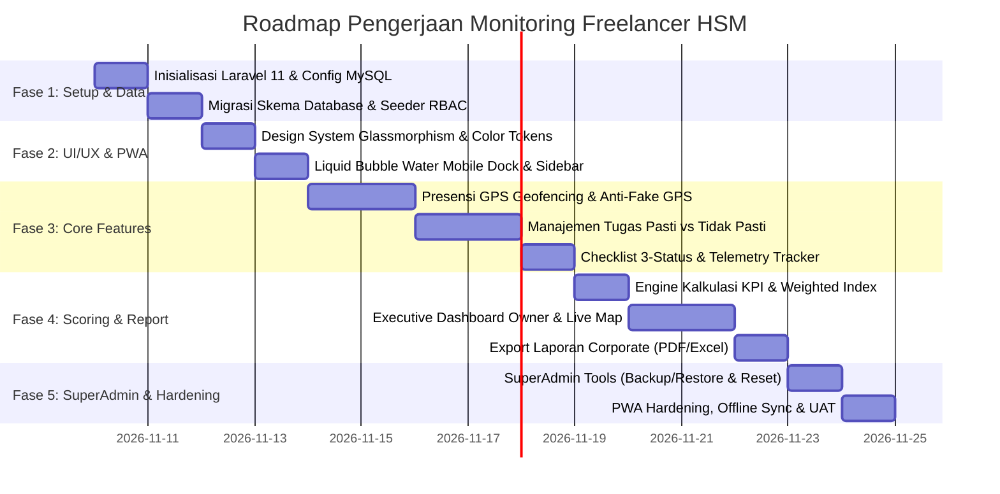

# PRODUCT REQUIREMENTS DOCUMENT (PRD)
## Monitoring Freelancer HSM (`freelance.tikismd.id`)
**Versi:** 1.0.0-PROD-SPEC  
**Status:** DRAFT FINAL / READY FOR IMPLEMENTATION  
**Klasifikasi:** Internal Confidential  
**Target Platform:** PWA (Progressive Web App) Mobile-First & Responsive Desktop Web  

---

## 1. Executive Summary & Visi Produk

### 1.1. Latar Belakang & Problem Statement
Operasional lapangan HSM melibatkan tenaga kerja lepas (*freelancer*) yang ditugaskan di berbagai titik gerai fisik. Manajemen operasional menghadapi empat kendala utama:
1. **Ketidakpastian Kehadiran Fisik:** Sulit memastikan freelancer benar-benar berada di lokasi gerai dan kantor utama tanpa pengawasan langsung.
2. **Keterlambatan Pengerjaan & Deviasi SLA:** Ketiadaan pencatatan waktu mulai dan selesai per tugas membuat evaluasi durasi menjadi tidak terukur.
3. **Ketidakseimbangan Distribusi Tugas:** Sulit mengelola perpaduan tugas harian rutin (*fixed recurring*) dengan tugas dadakan (*ad-hoc*).
4. **Ketiadaan Evaluasi Kinerja Otomatis:** Rekapitulasi penilaian kinerja bersifat manual dan memakan waktu, sehingga *Owner* tidak dapat mengambil keputusan berbasis data secara cepat.

### 1.2. Visi Produk
Membangun platform pemantauan freelancer modern berbasis **Laravel 11 PWA** dengan antarmuka **Glassmorphism Deep Navy & Vibrant Orange**, menghadirkan pengalaman mobile kelas atas melalui navigasi **Liquid Water Bubble Motion**, serta menyediakan **Executive Analytics Dashboard** dan laporan korporat berstandar formal bagi jajaran manajemen dan Owner.

### 1.3. Tujuan & Key Performance Indicators (OKR & Metrik)
- **Akurasi Validasi Lokasi:** 100% presensi dan pengerjaan tugas tervalidasi via Geofencing GPS (radius kantor/gerai $\le 50\text{ m}$).
- **Efisiensi Waktu (SLA):** Mengurangi tingkat keterlambatan tugas hingga $\ge 85\%$ dalam 30 hari pertama pasca-implementasi.
- **Transparansi Scoring:** Otomasi penilaian performa harian instan dengan bobot terukur (0–100) tanpa bias manual.
- **Kecepatan Akses Laporan:** Owner dapat mengakses laporan operasional dan performa real-time dalam $< 3$ detik.

---

## 2. Arsitektur Peran & Hak Akses (User Personas & RBAC Matrix)

Sistem dirancang dengan pembatasan hak akses berbasis peran (*Role-Based Access Control* / RBAC):



### 2.1. Matriks Otorisasi Fungsional

| Modul & Fitur | SuperAdmin | Admin HRD / SPV | Freelancer | Owner |
| :--- | :---: | :---: | :---: | :---: |
| **System Settings & Maintenance Mode** | Full CRUD | No Access | No Access | No Access |
| **Database Backup & Disaster Recovery** | Full CRUD | No Access | No Access | No Access |
| **User Management (Semua Role)** | Full CRUD | No Access | No Access | Read Only |
| **Reset Password Pengguna** | Eksekusi | Request Only | Profil Sendiri | No Access |
| **Master Data Gerai (GPS & Radius)** | Full CRUD | Full CRUD | Read Lokasi Tugas | Read Only |
| **Master Data Freelancer** | Full CRUD | Full CRUD | Profil Sendiri | Read Only |
| **Template Tugas Rutin Harian** | Full CRUD | Full CRUD | No Access | Read Only |
| **Distribusi Tugas Harian & Ad-Hoc** | Full CRUD | Full CRUD | Read Tugas Sendiri | Read Only |
| **Presensi GPS Kantor Utama** | View Audit | Validasi/Bypass | Wajib Eksekusi | View Rekap |
| **Checklist & Update Status Tugas** | Override/Log | Monitoring/Log | Eksekusi 3-Status | Read Only |
| **Kalkulasi & Rekalibrasi Nilai KPI** | Full Access | Full Access | View Nilai Sendiri | View Agregat |
| **Executive Analytics & Live Outlet Map** | Full Access | Full Access | No Access | Full Access (Ultra) |
| **Export Dokumen Corporate (PDF/Excel)** | Full Access | Full Access | Slip Kinerja Sendiri | Full Access |

---

## 3. Spesifikasi Fungsional Modul & Alur Kerja Bisnis

---

### Modul 1: Autentikasi, Profil & Keamanan (Multi-Role Auth)
- **ID Fitur:** `MOD-AUTH-01`
- **Aktor:** Semua Role (`superadmin`, `admin_hrd`, `freelancer`, `owner`)
- **Spesifikasi:**
  1. Login menggunakan kredensial `email` dan `password` dengan proteksi rate-limiting (*throttling* 5 percobaan gagal per menit).
  2. Redirection otomatis pasca-login:
     - `superadmin` $\rightarrow$ `/admin/dashboard`
     - `admin_hrd` $\rightarrow$ `/hrd/dashboard`
     - `freelancer` $\rightarrow$ `/pwa/workspace` (Tampilan mobile task list)
     - `owner` $\rightarrow$ `/owner/executive-dashboard`
  3. Mekanisme *Remember Me* aman via Laravel session cookie terenkripsi.
  4. Modul SuperAdmin: **Quick Reset Password Generator**. SuperAdmin dapat men-generate password baru acak 8 karakter berkekuatan tinggi, meng-update akun, dan menyalin format pesan instruksi untuk WhatsApp dengan satu klik.

---

### Modul 2: Presensi GPS & Geofencing Kantor Utama (Attendance Engine)
- **ID Fitur:** `MOD-ATT-02`
- **Aktor:** Freelancer, Admin HRD, SuperAdmin
- **Spesifikasi:**
  1. Freelancer wajib melakukan presensi hadir sebelum dapat memulai tugas apa pun pada hari tersebut.
  2. Lokasi presensi terkunci pada **Kantor Utama HSM** (`is_main_office = 1`).
  3. Formula Jarak Menggunakan **Haversine Formula**:
     $$d = 2r \arcsin\left(\sqrt{\sin^2\left(\frac{\Delta \phi}{2}\right) + \cos(\phi_1)\cos(\phi_2)\sin^2\left(\frac{\Delta \lambda}{2}\right)}\right)$$
     *Keterangan:* $r = 6.371.000\text{ meter}$, $\phi = \text{latitude in radians}$, $\lambda = \text{longitude in radians}$.
  4. Validasi Geofencing:
     - Jika $d \le \text{radius\_meter}$ (default 50 meter) dan akurasi GPS $\le 25\text{ meter}$, presensi diterima (`status = hadir_tepat` atau `terlambat`).
     - Jika $d > \text{radius\_meter}$, presensi ditolak dengan alert: *"Anda berada [d] meter di luar jangkauan Kantor Utama HSM. Silakan mendekat."*
  5. Anti-Fake GPS:
     - Menguji properti `geolocation.coords.accuracy`. Jika nilai akurasi $> 50\text{ meter}$, sistem memperingatkan kemungkinan sinyal buruk / emulasi.
     - Catatan koordinat dan waktu presensi dicatat pada level server secara atomik.

---

### Modul 3: Manajemen Master Data Gerai & Karyawan
- **ID Fitur:** `MOD-MST-03`
- **Aktor:** Admin HRD, SuperAdmin
- **Spesifikasi:**
  1. **Master Gerai / Outlets:**
     - Data: Kode Gerai, Nama Gerai, Alamat Lengkap, Koordinat Latitude, Koordinat Longitude, Radius Toleransi (meter), Status Kantor Utama (`true/false`), Status Operasional Aktif.
     - Interaksi Peta: Integrasi Leaflet.js dengan pin marker interaktif untuk menentukan koordinat dan lingkaran radius transparan biru.
  2. **Master Freelancer:**
     - Data: NIK, Nama Lengkap, Nomor WhatsApp, Email, Keahlian/Spesialisasi, Tarif Satuan Tugas/Jam (jika relevan), Status Keaktifan Akun.
     - Hubungan: Setiap freelancer dapat diasosiasikan dengan riwayat penugasan di gerai tertentu.

---

### Modul 4: Manajemen & Penugasan Tugas (Task Lifecycle & Checklist)
- **ID Fitur:** `MOD-TSK-04`
- **Aktor:** Admin HRD, Freelancer
- **Spesifikasi Pembagian Kategori Tugas:**
  1. **Tugas Pasti Harian (Fixed Recurring Tasks):**
     - Tugas template yang secara otomatis digenerate setiap hari kerja pada pukul 06:00 WIB.
     - Contoh: Pengecekan inventaris pagi, pembersihan mesin/perangkat gerai, penutupan kas & rekap harian.
  2. **Tugas Tidak Pasti (Ad-Hoc / Dynamic Tasks):**
     - Tugas insidental yang dibuat oleh Admin HRD secara fleksibel di tengah jam operasional.
     - Contoh: Penanganan keluhan gerai B, pengiriman suplai darurat, perbaikan unit gerai C.
  3. **Atribut Wajib Setiap Penugasan:**
     - `scheduled_start_time`: Jam target mulai eksekusi.
     - `estimated_duration_minutes`: Estimasi durasi pengerjaan standar (SLA).
     - `outlet_id`: Titik lokasi pengerjaan fisik tugas.

#### State Machine Siklus Pengerjaan Tugas:



- **Validasi Transisi Status:**
  - Status `Belum Diproses` $\rightarrow$ `Sedang Diproses`:
    - Memverifikasi apakah karyawan sudah presensi masuk hari ini. Jika belum, muncul SweetAlert: *"Presensi masuk diperlukan sebelum memulai tugas."*
    - Merekam koordinat GPS saat tombol ditekan.
  - Status `Sedang Diproses` $\rightarrow$ `Selesai Diproses`:
    - Menghitung $\Delta t = \text{completed\_at} - \text{started\_at}$.
    - Input form ringkas: Catatan pengerjaan (*mandatory minimal 10 karakter*), Unggah foto bukti pengerjaan (opsional/kondisional, kompresi otomatis client-side $< 800\text{KB}$).

---

### Modul 5: Mesin Kalkulasi Performa & Indeks Kinerja (KPI Engine)
- **ID Fitur:** `MOD-KPI-05`
- **Aktor:** System Automaton, Admin HRD, Owner
- **Spesifikasi:**
  Setiap hari pukul 23:59 WIB (atau dipicu secara instan saat seluruh tugas harian selesai), sistem menghitung skor kinerja harian individu:

$$\text{Final KPI Score} = (0.35 \times S_{\text{selesai}}) + (0.30 \times S_{\text{waktu}}) + (0.20 \times S_{\text{lokasi}}) + (0.15 \times S_{\text{kehadiran}})$$

#### Rincian Sub-Skor:
1. **Skor Penyelesaian ($S_{\text{selesai}}$, Bobot 35%):**
   $$S_{\text{selesai}} = \left(\frac{N_{\text{selesai}}}{N_{\text{total}}}\right) \times 100$$
2. **Skor Ketepatan Waktu ($S_{\text{waktu}}$, Bobot 30%):**
   Untuk setiap tugas yang selesai:
   $$\text{Deviasi} = \text{Durasi Aktual} - \text{Estimasi SLA (menit)}$$
   - Jika $\text{Deviasi} \le 0$: Skor Tugas $= 100$
   - Jika $0 < \text{Deviasi} \le 15$: Skor Tugas $= 85$
   - Jika $\text{Deviasi} > 15$: Skor Tugas $= \max\left(0, 100 - (2.5 \times \text{Deviasi})\right)$
   $$S_{\text{waktu}} = \text{Rata-rata Skor Tugas}$$
3. **Skor Kepatuhan Lokasi ($S_{\text{lokasi}}$, Bobot 20%):**
   Mengukur apakah pengerjaan dilakukan di koordinat gerai yang benar:
   $$S_{\text{lokasi}} = \left(\frac{N_{\text{lokasi valid}}}{N_{\text{total tugas}}}\right) \times 100$$
4. **Skor Kehadiran ($S_{\text{kehadiran}}$, Bobot 15%):**
   - Presensi tepat waktu di kantor utama $= 100$
   - Presensi terlambat $\le 15$ menit $= 80$
   - Presensi terlambat $> 15$ menit $= 50$
   - Tidak presensi / Alpha $= 0$

#### Skala Predikat:
- **Grade A (90.00 – 100.00):** *Sangat Unggul / Luar Biasa* (Badge Hijau Emerald)
- **Grade B (80.00 – 89.99):** *Memuaskan / Sesuai Standar* (Badge Biru Safir)
- **Grade C (70.00 – 79.99):** *Cukup / Memerlukan Perhatian* (Badge Kuning Amber)
- **Grade D (< 70.00):** *Kurang / Perlu Tindakan Evaluasi* (Badge Merah Crimson)

---

### Modul 6: Executive Dashboard & Visualisasi Analitik (Owner View)
- **ID Fitur:** `MOD-DSH-06`
- **Aktor:** Owner, SuperAdmin, Admin HRD
- **Spesifikasi:**
  1. **Top KPI Summary Cards:**
     - *Total Freelancer Aktif Hari Ini*
     - *Tingkat Penyelesaian Tugas Global (%)*
     - *Total Jam Produktif Operasional*
     - *Rata-rata Skor Kinerja Keseluruhan*
  2. **Live Outlet Map & Sebaran Freelancer:**
     - Peta Leaflet.js dengan marker interaktif untuk setiap gerai.
     - Indikator status gerai: Hijau (semua tugas on-track), Oranye (ada tugas sedang berjalan), Merah (ada tugas terlambat/terkendala).
  3. **Leaderboard Performa:**
     - Top 5 Freelancer Berprestasi (Skor tertinggi & kecepatan SLA).
     - Daftar 5 Freelancer yang memerlukan pembinaan (*Underperforming List*).
  4. **Grafik Analitik Terintegrasi (Chart.js):**
     - *Trend Produktivitas 30 Hari*: Line chart dengan gradient neon orange & fill navy.
     - *Distribusi Beban Kerja per Gerai*: Horizontal Bar chart.
     - *Multi-Dimensional Performance Radar*: Membandingkan Metrik Kualitas, Kecepatan, Kehadiran, dan Kepatuhan Lokasi.

---

### Modul 7: Sistem Laporan Korporat Profesional (Corporate Reporting)
- **ID Fitur:** `MOD-REP-07`
- **Aktor:** Owner, Admin HRD, SuperAdmin
- **Spesifikasi:**
  1. Ekspor dalam format **PDF Resmi (A4 Landscape/Portrait)** dan **Excel (.xlsx)**.
  2. **Komponen Standar Laporan Korporat:**
     - **Header Perusahaan HSM:** Logo resmi, Nama Entitas, Alamat Kantor Pusat, Tlp/Email.
     - **Metadata Audit:** Nomor Dokumen (`DOC/HSM-FL/REP/2026/001`), Tanggal & Waktu Cetak, Nama Pencetak, Status: *CONFIDENTIAL*.
     - **Ringkasan Eksekutif Terstruktur:** Statistik agregat periode terpilih.
     - **Tabel Data Terformat:** Zebra-striping elegan, badge warna status yang tetap kontras saat dicetak hitam-putih.
     - **Section Tanda Tangan Formal:**
       - Kolom Disiapkan Oleh (Supervisor / HRD)
       - Kolom Diverifikasi Oleh (HRD Manager)
       - Kolom Disetujui Oleh (Direktur Utama / Owner)
  3. **Opsi Filter Fleksibel:** Rentang Tanggal, Filter Gerai Tertentu, Filter Karyawan Tertentu, Filter Status Grade (A/B/C/D).

---

### Modul 8: SuperAdmin Control, Keamanan & Backup/Restore
- **ID Fitur:** `MOD-ADM-08`
- **Aktor:** SuperAdmin
- **Spesifikasi:**
  1. **Manajemen User Komprehensif:** Pembuatan akun, penonaktifan akun secara instan, perombakan role.
  2. **Backup & Restore Database MySQL:**
     - *Manual On-Demand Backup:* SuperAdmin menekan tombol "Buat Cadangan Baru", sistem menjalankan `mysqldump` terkompresi `gzip`, disimpan di `/storage/app/backups/`.
     - *Download Backup:* Fitur download file `.sql.gz`.
     - *Safe Restore Wizard:* Fitur upload file `.sql` atau `.sql.gz` dengan konfirmasi keamanan berlapis (wajib ketik kalimat konfirmasi "RESTORE HSM DATABASE").
     - *Auto Daily Backup:* Terjadwal via Laravel Scheduler setiap pukul 01:00 WIB.
  3. **Audit Trail Log:** Mencatat riwayat penting: waktu login, perubahan status tugas, rekalibrasi nilai, dan aktivitas backup.

---

## 4. Spesifikasi UI/UX & Design System

### 4.1. Filosofi & Palet Warna (Glassmorphism Corporate Luxury)
- Menggabungkan wibawa korporat (*Deep Navy*) dengan aksen produktivitas aktif (*Vibrant Orange*).

| Elemen UI | Nilai Hex / CSS | Penjelasan |
| :--- | :--- | :--- |
| **Canvas Background** | `#08101C` | Deep Midnight Navy untuk kedalaman visual |
| **Glass Card Background** | `rgba(14, 30, 54, 0.65)` | Semi-transparan dengan `backdrop-filter: blur(16px)` |
| **Glass Border Stroke** | `rgba(255, 255, 255, 0.10)` | Garis tepian kaca halus dengan refleksi cahaya |
| **Primary Accent Color** | `#FF6500` | Oranye menyala untuk tombol aksi utama, floating dock, badge aktif |
| **Secondary Accent Color** | `#FF8800` & `#00D2FF` | Gradasi oranye hangat & aksen cyan untuk indikator info |
| **Typography Heading** | `#FFFFFF` (Inter / Plus Jakarta Sans) | Kontras tinggi, tegas, dan modern |
| **Typography Body Text** | `#94A3B8` s/d `#CBD5E1` | Keterbacaan optimal tanpa silau di layar gelap |
| **Success / Warning / Danger** | `#10B981` / `#F59E0B` / `#EF4444` | Penanda status dengan nuansa neon elegan |

---

### 4.2. Mobile-First: Animated "Water Bubble" Bottom Dock (Figma Motion)

Navigasi bawah pada perangkat mobile dirancang dengan konsep *liquid fluid dock*:
1. **Bentuk & Peletakan:** Floating pill di bagian bawah layar dengan jarak aman (*safe-area-inset-bottom* untuk iPhone/Android gesture bar).
2. **Animasi Gelembung Air (Water Bubble Dynamic):**
   - Indikator aktif berupa elemen melingkar bercahaya oranye yang berpindah secara dinamis mengikuti menu yang dipilih.
   - Menggunakan kurva fisika pegas kental: `transition: all 0.5s cubic-bezier(0.34, 1.56, 0.64, 1)`.
   - Saat disentuh (*tap*), gelembung sedikit memipih secara horizontal lalu mengembang (*squash and stretch*), menyerupai tetesan cairan kental yang merembes.
   - Ikon yang aktif naik sedikit ke atas (-4px) disertai riak pendaran lembut (*diffused orange glow*).
3. **Menu Tab Mobile (Freelancer):**
   - 🏠 **Beranda / Workspace:** Ringkasan presensi & highlight tugas hari ini.
   - 📋 **Tugas Saya:** Daftar interaktif tugas (Pasti & Ad-hoc) dengan status checklist.
   - 📍 **Presensi GPS:** Layar pemindaian geofencing & tombol check-in/out.
   - 📊 **Kinerja Saya:** Ringkasan skor KPI & performa personal.
   - 👤 **Profil:** Pengaturan akun & tombol logout.

---

### 4.3. Tablet & Desktop: Luxury Collapsible Sidebar

Navigasi desktop mengadopsi layout korporat berkelas:
1. **Material:** Kaca semi-transparan vertikal di sisi kiri (`w-64`), dapat diminimalkan (*collapse*) menjadi mode ikon (`w-20`).
2. **Efek Micro-Interaction:**
   - Hover pada item menu menampilkan pendaran halus *gradient-navy-to-orange* di tepian kiri (*active pill glow*).
   - Transisi *ease-in-out* 300ms yang sangat mulus tanpa lag.
3. **Footer Status PWA:**
   - Menampilkan status jaringan (*Online / Offline Sync*), versi sistem, dan pintasan cepat.

---

### 4.4. Dialog Interaktif & Notifikasi (SweetAlert2 Custom Glass)
- Dialog SweetAlert2 dikustomisasi penuh mengikuti tema gelap glassmorphism:
  - Background: `rgba(14, 30, 54, 0.95)` dengan border `rgba(255, 101, 0, 0.3)`.
  - Icon: Animasi centang atau seru bergaya neon halus.
  - Tombol Konfirmasi: Tombol oranye rounded bergradasi dengan bayangan bersinar (*glowing drop shadow*).

---

## 5. Arsitektur Teknis & Skema Database Lengkap

### 5.1. Tech Stack & Environment
- **Framework:** Laravel 11.x (PHP 8.2+)
- **Database:** MySQL 8.0+ (Engine InnoDB, Strict Mode, UTF8MB4)
- **Frontend Stack:** Laravel Blade, Tailwind CSS v3, Alpine.js (State & Liquid Motion Controller)
- **Visualisasi & Peta:** Chart.js, Leaflet.js
- **PWA Capabilities:** Web App Manifest, Service Worker dengan Cache-First untuk aset statis dan Network-First untuk API transaksi tugas.

---

### 5.2. Skema Tabel Database MySQL (Data Definition Language)

```sql
-- 1. TABEL USERS
CREATE TABLE `users` (
  `id` BIGINT UNSIGNED AUTO_INCREMENT PRIMARY KEY,
  `nik` VARCHAR(30) UNIQUE NULL,
  `name` VARCHAR(150) NOT NULL,
  `email` VARCHAR(150) UNIQUE NOT NULL,
  `phone` VARCHAR(25) NULL,
  `password` VARCHAR(255) NOT NULL,
  `role` ENUM('superadmin', 'admin_hrd', 'freelancer', 'owner') NOT NULL DEFAULT 'freelancer',
  `avatar` VARCHAR(255) NULL,
  `hourly_rate` DECIMAL(12,2) DEFAULT 0.00,
  `is_active` BOOLEAN NOT NULL DEFAULT TRUE,
  `remember_token` VARCHAR(100) NULL,
  `created_at` TIMESTAMP NULL DEFAULT CURRENT_TIMESTAMP,
  `updated_at` TIMESTAMP NULL DEFAULT CURRENT_TIMESTAMP ON UPDATE CURRENT_TIMESTAMP,
  INDEX `idx_users_role` (`role`),
  INDEX `idx_users_active` (`is_active`)
) ENGINE=InnoDB DEFAULT CHARSET=utf8mb4 COLLATE=utf8mb4_unicode_ci;

-- 2. TABEL OUTLETS (GERAI & KANTOR PUSAT)
CREATE TABLE `outlets` (
  `id` BIGINT UNSIGNED AUTO_INCREMENT PRIMARY KEY,
  `code` VARCHAR(20) UNIQUE NOT NULL,
  `name` VARCHAR(150) NOT NULL,
  `address` TEXT NOT NULL,
  `latitude` DECIMAL(10, 8) NOT NULL,
  `longitude` DECIMAL(11, 8) NOT NULL,
  `radius_meters` INT UNSIGNED NOT NULL DEFAULT 50,
  `is_main_office` BOOLEAN NOT NULL DEFAULT FALSE,
  `is_active` BOOLEAN NOT NULL DEFAULT TRUE,
  `created_at` TIMESTAMP NULL DEFAULT CURRENT_TIMESTAMP,
  `updated_at` TIMESTAMP NULL DEFAULT CURRENT_TIMESTAMP ON UPDATE CURRENT_TIMESTAMP,
  INDEX `idx_outlets_main_office` (`is_main_office`)
) ENGINE=InnoDB DEFAULT CHARSET=utf8mb4 COLLATE=utf8mb4_unicode_ci;

-- 3. TABEL TEMPLATE TUGAS RUTIN (TASK TEMPLATES)
CREATE TABLE `task_templates` (
  `id` BIGINT UNSIGNED AUTO_INCREMENT PRIMARY KEY,
  `title` VARCHAR(200) NOT NULL,
  `description` TEXT NULL,
  `task_type` ENUM('pasti_harian', 'tidak_pasti') NOT NULL DEFAULT 'pasti_harian',
  `estimated_duration_minutes` INT UNSIGNED NOT NULL DEFAULT 30,
  `default_outlet_id` BIGINT UNSIGNED NULL,
  `is_active` BOOLEAN NOT NULL DEFAULT TRUE,
  `created_at` TIMESTAMP NULL DEFAULT CURRENT_TIMESTAMP,
  `updated_at` TIMESTAMP NULL DEFAULT CURRENT_TIMESTAMP ON UPDATE CURRENT_TIMESTAMP,
  CONSTRAINT `fk_templates_outlet` FOREIGN KEY (`default_outlet_id`) REFERENCES `outlets` (`id`) ON DELETE SET NULL
) ENGINE=InnoDB DEFAULT CHARSET=utf8mb4 COLLATE=utf8mb4_unicode_ci;

-- 4. TABEL PENUGASAN TUGAS (TASK ASSIGNMENTS)
CREATE TABLE `task_assignments` (
  `id` BIGINT UNSIGNED AUTO_INCREMENT PRIMARY KEY,
  `task_number` VARCHAR(30) UNIQUE NOT NULL,
  `user_id` BIGINT UNSIGNED NOT NULL,
  `outlet_id` BIGINT UNSIGNED NOT NULL,
  `task_template_id` BIGINT UNSIGNED NULL,
  `title` VARCHAR(200) NOT NULL,
  `description` TEXT NULL,
  `task_type` ENUM('pasti_harian', 'tidak_pasti') NOT NULL DEFAULT 'pasti_harian',
  `assigned_date` DATE NOT NULL,
  `scheduled_start_time` TIME NOT NULL,
  `estimated_duration_minutes` INT UNSIGNED NOT NULL DEFAULT 30,
  `status` ENUM('pending', 'in_progress', 'completed', 'cancelled') NOT NULL DEFAULT 'pending',
  `started_at` TIMESTAMP NULL,
  `start_latitude` DECIMAL(10, 8) NULL,
  `start_longitude` DECIMAL(11, 8) NULL,
  `completed_at` TIMESTAMP NULL,
  `end_latitude` DECIMAL(10, 8) NULL,
  `end_longitude` DECIMAL(11, 8) NULL,
  `actual_duration_minutes` INT UNSIGNED NULL,
  `notes` TEXT NULL,
  `proof_image` VARCHAR(255) NULL,
  `is_location_valid` BOOLEAN NULL,
  `created_by` BIGINT UNSIGNED NOT NULL,
  `created_at` TIMESTAMP NULL DEFAULT CURRENT_TIMESTAMP,
  `updated_at` TIMESTAMP NULL DEFAULT CURRENT_TIMESTAMP ON UPDATE CURRENT_TIMESTAMP,
  CONSTRAINT `fk_tasks_user` FOREIGN KEY (`user_id`) REFERENCES `users` (`id`) ON DELETE CASCADE,
  CONSTRAINT `fk_tasks_outlet` FOREIGN KEY (`outlet_id`) REFERENCES `outlets` (`id`) ON DELETE CASCADE,
  CONSTRAINT `fk_tasks_template` FOREIGN KEY (`task_template_id`) REFERENCES `task_templates` (`id`) ON DELETE SET NULL,
  CONSTRAINT `fk_tasks_creator` FOREIGN KEY (`created_by`) REFERENCES `users` (`id`),
  INDEX `idx_tasks_user_date` (`user_id`, `assigned_date`),
  INDEX `idx_tasks_status` (`status`)
) ENGINE=InnoDB DEFAULT CHARSET=utf8mb4 COLLATE=utf8mb4_unicode_ci;

-- 5. TABEL PRESENSI (ATTENDANCES)
CREATE TABLE `attendances` (
  `id` BIGINT UNSIGNED AUTO_INCREMENT PRIMARY KEY,
  `user_id` BIGINT UNSIGNED NOT NULL,
  `outlet_id` BIGINT UNSIGNED NOT NULL,
  `date` DATE NOT NULL,
  `check_in_at` TIMESTAMP NOT NULL,
  `check_in_latitude` DECIMAL(10, 8) NOT NULL,
  `check_in_longitude` DECIMAL(11, 8) NOT NULL,
  `check_in_distance_meters` INT NOT NULL,
  `check_out_at` TIMESTAMP NULL,
  `check_out_latitude` DECIMAL(10, 8) NULL,
  `check_out_longitude` DECIMAL(11, 8) NULL,
  `status` ENUM('hadir_tepat', 'terlambat', 'invalid_radius') NOT NULL DEFAULT 'hadir_tepat',
  `notes` VARCHAR(255) NULL,
  `created_at` TIMESTAMP NULL DEFAULT CURRENT_TIMESTAMP,
  `updated_at` TIMESTAMP NULL DEFAULT CURRENT_TIMESTAMP ON UPDATE CURRENT_TIMESTAMP,
  CONSTRAINT `fk_attendance_user` FOREIGN KEY (`user_id`) REFERENCES `users` (`id`) ON DELETE CASCADE,
  CONSTRAINT `fk_attendance_outlet` FOREIGN KEY (`outlet_id`) REFERENCES `outlets` (`id`) ON DELETE CASCADE,
  UNIQUE KEY `uk_user_daily_attendance` (`user_id`, `date`)
) ENGINE=InnoDB DEFAULT CHARSET=utf8mb4 COLLATE=utf8mb4_unicode_ci;

-- 6. TABEL LOG EVALUASI KINERJA (PERFORMANCE LOGS)
CREATE TABLE `performance_logs` (
  `id` BIGINT UNSIGNED AUTO_INCREMENT PRIMARY KEY,
  `user_id` BIGINT UNSIGNED NOT NULL,
  `evaluation_date` DATE NOT NULL,
  `total_tasks` INT UNSIGNED NOT NULL DEFAULT 0,
  `completed_tasks` INT UNSIGNED NOT NULL DEFAULT 0,
  `completion_score` DECIMAL(5,2) NOT NULL DEFAULT 0.00,
  `time_score` DECIMAL(5,2) NOT NULL DEFAULT 0.00,
  `location_score` DECIMAL(5,2) NOT NULL DEFAULT 0.00,
  `attendance_score` DECIMAL(5,2) NOT NULL DEFAULT 0.00,
  `final_kpi_score` DECIMAL(5,2) NOT NULL DEFAULT 0.00,
  `grade` ENUM('A', 'B', 'C', 'D') NOT NULL DEFAULT 'C',
  `remarks` TEXT NULL,
  `created_at` TIMESTAMP NULL DEFAULT CURRENT_TIMESTAMP,
  `updated_at` TIMESTAMP NULL DEFAULT CURRENT_TIMESTAMP ON UPDATE CURRENT_TIMESTAMP,
  CONSTRAINT `fk_perf_user` FOREIGN KEY (`user_id`) REFERENCES `users` (`id`) ON DELETE CASCADE,
  UNIQUE KEY `uk_user_perf_date` (`user_id`, `evaluation_date`),
  INDEX `idx_perf_grade` (`grade`)
) ENGINE=InnoDB DEFAULT CHARSET=utf8mb4 COLLATE=utf8mb4_unicode_ci;

-- 7. TABEL BACKUP SISTEM & DATABASE (SYSTEM BACKUPS)
CREATE TABLE `system_backups` (
  `id` BIGINT UNSIGNED AUTO_INCREMENT PRIMARY KEY,
  `filename` VARCHAR(255) NOT NULL,
  `file_path` VARCHAR(255) NOT NULL,
  `file_size_bytes` BIGINT UNSIGNED NOT NULL,
  `backup_type` ENUM('auto_scheduled', 'manual_superadmin') NOT NULL DEFAULT 'manual_superadmin',
  `status` ENUM('success', 'failed') NOT NULL DEFAULT 'success',
  `created_by` BIGINT UNSIGNED NULL,
  `created_at` TIMESTAMP NULL DEFAULT CURRENT_TIMESTAMP,
  CONSTRAINT `fk_backups_user` FOREIGN KEY (`created_by`) REFERENCES `users` (`id`) ON DELETE SET NULL
) ENGINE=InnoDB DEFAULT CHARSET=utf8mb4 COLLATE=utf8mb4_unicode_ci;
```

---

## 6. Format Laporan Korporat Profesional (Corporate Standards)

Laporan ditujukan untuk konsumsi jajaran Direksi, Investor, dan Manajemen HRD dengan spesifikasi tata letak:

```
+-----------------------------------------------------------------------------------+
|  [LOGO HSM]   PT HSM LOGISTIK & EKSPEDISI NUSANTARA                               |
|               Sistem Informasi Manajemen Freelancer Operasional                   |
|               Dokumen: DOC/HSM-FL/REP/2026/001 | Status: RAHASIA / CONFIDENTIAL   |
+-----------------------------------------------------------------------------------+
|  LAPORAN KOMPREHENSIF PERFORMA & EVALUASI OPERASIONAL FREELANCER                 |
|  Periode: 01 November 2026 s/d 10 November 2026                                   |
+-----------------------------------------------------------------------------------+
|  RINGKASAN EKSEKUTIF:                                                             |
|  - Total Freelancer Evaluasi : 24 Personel     - Tingkat On-Time SLA : 91.4%     |
|  - Total Tugas Ditugaskan    : 380 Tugas       - Rata-rata Skor KPI : 88.65 (B)   |
|  - Total Tugas Terselesaikan : 374 Tugas       - Pelanggaran Lokasi : 2 Kasus     |
+-----------------------------------------------------------------------------------+
|  TABEL RINCIAN PERFORMA PER FREELANCER:                                           |
|  +-----+------------------+-------------+------------+----------+-------+-------+ |
|  | No  | Nama Freelancer  | Tugas (C/T) | Durasi Rata| Akurasi  | KPI   | Grade | |
|  +-----+------------------+-------------+------------+----------+-------+-------+ |
|  | 01  | Ahmad Rizky      | 45 / 45     | 24 Menit   | 100%     | 96.20 |   A   | |
|  | 02  | Budi Santoso     | 42 / 44     | 31 Menit   | 98.2%    | 88.40 |   B   | |
|  | ... | ...              | ...         | ...        | ...      | ...   |  ...  | |
|  +-----+------------------+-------------+------------+----------+-------+-------+ |
+-----------------------------------------------------------------------------------+
|  CATATAN AUDIT & REKOMENDASI MANAJEMEN:                                           |
|  1. Disiplin waktu meningkat 14% pasca-penerapan geofencing otomatis.            |
|  2. Terdapat 2 kasus keterlambatan di Gerai Samarinda Ilir karena kendala armada. |
+-----------------------------------------------------------------------------------+
|  LEMBAR PENGESAHAN RESMI:                                                         |
|                                                                                   |
|     Dipersiapkan Oleh,          Diverifikasi Oleh,          Disetujui Oleh,       |
|                                                                                   |
|     ( Supervisor Ops )           ( HRD Manager )             ( Owner / Direktur ) |
|     Tgl: ____________            Tgl: ____________           Tgl: ____________    |
+-----------------------------------------------------------------------------------+
```

---

## 7. Kriteria Penerimaan Sistem (Acceptance Criteria / Gherkin)

### Skenario 1: Presensi GPS Geofencing Kantor Utama
```gherkin
Feature: Presensi Kehadiran Freelancer berbasis Geofencing GPS

  Scenario: Presensi berhasil di dalam radius 50 meter kantor utama
    Given Karyawan freelancer telah login ke akun mereka di aplikasi PWA
    And Karyawan berada pada jarak 20 meter dari titik koordinat Kantor Utama HSM
    When Karyawan membuka menu presensi dan menekan tombol "Presensi Masuk Sekarang"
    Then Sistem mencatat timestamp presensi masuk
    And Koordinat GPS berhasil divalidasi
    And Status presensi tercatat sebagai "hadir_tepat"
    And Muncul SweetAlert sukses: "Presensi Masuk Berhasil Dikonfirmasi"

  Scenario: Presensi ditolak karena di luar radius kantor utama
    Given Karyawan freelancer berada pada jarak 180 meter dari Kantor Utama HSM
    When Karyawan menekan tombol "Presensi Masuk Sekarang"
    Then Sistem menolak presensi masuk
    And Muncul SweetAlert peringatan: "Presensi Gagal: Anda berada 180m di luar jangkauan area kantor utama."
    And Tombol pengerjaan tugas tetap terkunci
```

### Skenario 2: Siklus Pengerjaan Tugas 3-Status & Pencatatan Telemetri
```gherkin
Feature: Pengerjaan Tugas Harian

  Scenario: Freelancer memulai pengerjaan tugas
    Given Karyawan telah sukses melakukan presensi masuk
    And Terdapat tugas dengan status "Belum Diproses"
    When Karyawan menekan tombol "Mulai Kerjakan"
    Then Status tugas berubah menjadi "Sedang Diproses"
    And Sistem mengunci waktu "started_at" secara server-side
    And Sistem merekam "start_latitude" dan "start_longitude"
    And Indikator timer pengerjaan mulai berjalan di antarmuka mobile

  Scenario: Freelancer menyelesaikan tugas
    Given Tugas berstatus "Sedang Diproses"
    When Karyawan menekan tombol "Selesai Pengerjaan"
    And Mengisi catatan pengerjaan "Pengecekan stok rak A sampai F selesai tanpa selisih"
    Then Status tugas berubah menjadi "Selesai Diproses"
    And Sistem menghitung "actual_duration_minutes"
    And Sistem memvalidasi apakah durasi sesuai SLA
    And Skor performa tugas dikirim ke modul evaluasi harian
```

### Skenario 3: SuperAdmin Melakukan Backup dan Reset Kredensial
```gherkin
Feature: Utilitas SuperAdmin

  Scenario: SuperAdmin melakukan reset password cepat freelancer
    Given SuperAdmin berada di menu Manajemen Pengguna
    When SuperAdmin memilih freelancer "Budi Santoso" dan mengklik "Quick Reset Password"
    Then Sistem menghasilkan password baru acak 8 karakter terenkripsi
    And Sistem menampilkan modal berisi kredensial baru
    And Terdapat tombol "Salin Template Pesan WhatsApp" siap kirim

  Scenario: SuperAdmin mengeksekusi On-Demand Backup Database
    Given SuperAdmin berada di menu Pengaturan & Database
    When SuperAdmin menekan tombol "Buat Cadangan Database Baru"
    Then Sistem memicu proses mysqldump terkompresi .sql.gz
    And File tersimpan aman di direktori cadangan
    And Tabel riwayat backup mencatat nama file, ukuran, dan waktu pembuatan
```

---

## 8. Rencana Implementasi & Roadmap Pengembangan



---

> [!IMPORTANT]
> Dokumen PRD ini adalah acuan spesifikasi definitif untuk seluruh pengembangan kode di `freelance.tikismd.id`. Seluruh implementasi model, migrasi, controller, tampilan Blade, dan skrip Alpine.js/PWA wajib berpedoman pada struktur dan aturan bisnis yang tertuang di sini.
