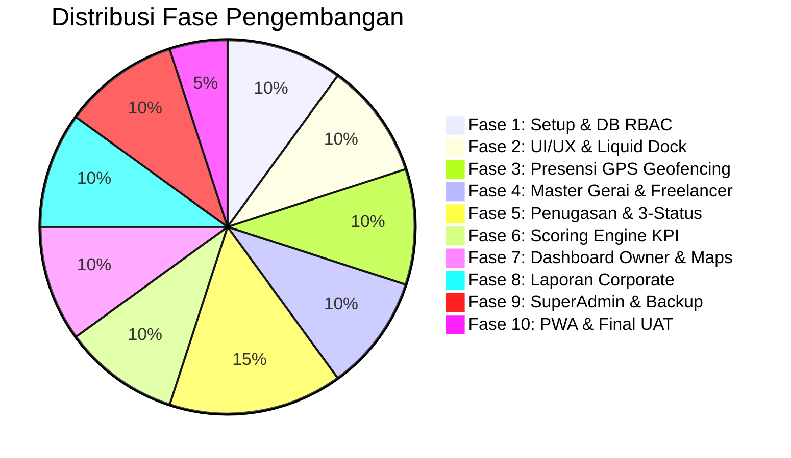

# MASTER TODO & PANDUAN MANDOR IMPLEMENTASI
## Monitoring Freelancer HSM (`freelance.tikismd.id`)

**Dokumen Acuan:** [konsep.md](file:///root/.gemini/antigravity-cli/scratch/freelance.tikismd.id/konsep.md) & [PRD.md](file:///root/.gemini/antigravity-cli/scratch/freelance.tikismd.id/PRD.md)  
**Status Proyek:** 100% COMPLETED & VERIFIED (PRODUCTION READY)  
**Target Platform:** Laravel 11, MySQL, Tailwind CSS, Alpine.js, PWA Mobile-First & Responsive Web  

---

## 📌 Prinsip & Peraturan Mandor (Standard Operating Procedure)

1. **Prinsip Step-by-Step Tanpa Melewatkan Verifikasi:**
   - Setiap fase wajib dituntaskan dan diuji sebelum beralih ke fase berikutnya.
   - Setiap kali task selesai, tandai checkbox `[x]` pada dokumen ini sebagai rekam jejak progres.
2. **Kepatuhan Desain & Brand Identity:**
   - Palet warna wajib: *Deep Navy Corporate* (`#08101C` / `#0E1E36`) dan aksen *Vibrant Orange* (`#FF6500`).
   - Komponen wajib mengusung tema *Glassmorphism* (`backdrop-filter: blur()`, border semi-transparan tipis).
   - Navigasi mobile wajib menerapkan animasi fluida *Water Bubble* (Figma spring motion).
   - Sidebar desktop wajib berkelas luxury dengan collapsible smooth drawer.
3. **Integritas Bisnis & Anti-Kecurangan:**
   - Validasi Geofencing GPS (Haversine formula) dan pengecekan akurasi hardware wajib dieksekusi secara server-side.
   - State pengerjaan tugas wajib mengikuti alur kaku: `pending` $\rightarrow$ `in_progress` $\rightarrow$ `completed`. Karyawan dilarang memulai tugas sebelum presensi hadir di kantor utama.
4. **Kualitas Pelaporan Korporat:**
   - Laporan PDF/Excel wajib memiliki format formal (Kop surat HSM, nomor dokumen, ringkasan eksekutif, tabel zebra, dan 3 kolom tanda tangan resmi).

---

## 🧭 Ringkasan Progress Fase

---

## 📋 DAFTAR TUGAS ULTRA DETAIL PER FASE

---

### FASE 1: Inisialisasi Proyek, Basis Data & Multi-Role RBAC
> **Tujuan:** Menyiapkan fondasi Laravel 11, koneksi MySQL yang stabil, skema tabel komprehensif, dan sistem otentikasi 4 role dengan redirection otomatis.

- [x] **TASK-1.1: Inisialisasi Framework & Package Pendukung**
  - [x] Pasang Laravel 11 di direktori proyek `freelance.tikismd.id`.
  - [x] Konfigurasi environment `.env` (App Name: `Monitoring Freelancer HSM`, URL, App Key).
  - [x] Pasang package pendukung: `barryvdh/laravel-dompdf`, `maatwebsite/excel`.
  - [x] Pasang frontend build: Tailwind CSS, Alpine.js, Vite.
- [x] **TASK-1.2: Konfigurasi Database & Migrasi Skema MySQL**
  - [x] Buat database `freelance_hsm` di MySQL.
  - [x] Buat file migrasi `users` (tambahkan kolom `nik`, `phone`, `role`, `hourly_rate`, `is_active`, `avatar`).
  - [x] Buat file migrasi `outlets` (kode, nama, alamat, `latitude`, `longitude`, `radius_meters`, `is_main_office`, `is_active`).
  - [x] Buat file migrasi `task_templates` (judul, deskripsi, `task_type`, `estimated_duration_minutes`, `default_outlet_id`).
  - [x] Buat file migrasi `task_assignments` (nomor tugas unik, user FK, outlet FK, template FK, tipe tugas, tanggal, jadwal, durasi estimasi, status, GPS start/end, actual duration, catatan, bukti gambar).
  - [x] Buat file migrasi `attendances` (user FK, outlet FK, tanggal, check-in/out timestamp, GPS koordinat, jarak meter, status, notes).
  - [x] Buat file migrasi `performance_logs` (user FK, evaluation date, sub-scores, final KPI, grade A/B/C/D).
  - [x] Buat file migrasi `system_backups` (filename, file_path, size, type, status, creator FK).
  - [x] Jalankan `php artisan migrate:fresh` dan pastikan semua indeks/foreign keys terbuat tanpa error.
- [x] **TASK-1.3: Seeder & Multi-Role Authentication Setup**
  - [x] Buat `UserSeeder` dengan 4 akun default:
    - SuperAdmin: `superadmin@hsm.id` / `Password123!`
    - Admin HRD: `hrd@hsm.id` / `Password123!`
    - Freelancer: `freelancer@hsm.id` / `Password123!`
    - Owner: `owner@hsm.id` / `Password123!`
  - [x] Buat `OutletSeeder` (Kantor Utama HSM + 3 Gerai Cabang di Samarinda).
  - [x] Buat Middleware `RoleMiddleware` untuk proteksi rute (`role:superadmin`, `role:admin_hrd`, `role:freelancer`, `role:owner`).
  - [x] Buat logika `LoginController` dengan multi-role redirection otomatis pasca-login.
  - [x] **Verifikasi Checkpoint 1:** Coba login untuk ke-4 akun dan pastikan mendarat pada rute dashboard masing-masing.

---

### FASE 2: Design System, Glassmorphism, & Navigasi Mobile "Water Bubble"
> **Tujuan:** Membangun antarmuka kelas dunia bergaya Deep Navy & Vibrant Orange, Floating Bubble Dock (Figma motion) untuk mobile, dan Luxury Collapsible Sidebar untuk desktop.

- [x] **TASK-2.1: Desain Token & Base Layout Blade**
  - [x] Konfigurasi Tailwind theme (`tailwind.config.js`) dengan warna kustom:
    - `navy-dark`: `#08101C`, `navy-surface`: `#0E1E36`, `navy-glass`: `rgba(14, 30, 54, 0.65)`
    - `orange-primary`: `#FF6500`, `orange-accent`: `#FF8800`, `cyan-accent`: `#00D2FF`
  - [x] Buat helper CSS untuk efek glassmorphism (`backdrop-blur-md`, subtle border light glow).
  - [x] Buat master layout `layouts.app` yang responsif (Mobile Viewport vs Desktop Viewport).
- [x] **TASK-2.2: Mobile Floating "Water Bubble" Bottom Dock**
  - [x] Buat komponen navigasi bawah mengambang (`bottom-dock.blade.php`) dengan 5 tab menu.
  - [x] Terapkan animasi fluida gelembung air menggunakan CSS spring transition (`cubic-bezier(0.34, 1.56, 0.64, 1)`):
    - Indikator gelembung aktif yang memipih (*squash & stretch*) saat berpindah tab.
    - Ikon aktif melompat halus (-4px) disertai pendaran neon oranye lembut (*soft orange water glow*).
    - Pastikan kompatibel dengan *safe-area-inset-bottom* (notch bar smartphone).
- [x] **TASK-2.3: Tablet & Desktop Luxury Sidebar**
  - [x] Buat komponen sidebar (`desktop-sidebar.blade.php`) dengan status collapsible (lebar 64 $\leftrightarrow$ 20).
  - [x] Terapkan efek hover micro-interaction dengan ambient gradient glow oranye pada tepian menu aktif.
  - [x] Integrasikan status konektivitas PWA (Online / Offline Sync badge).
- [x] **TASK-2.4: Integrasi SweetAlert2 Custom Glass Theme**
  - [x] Buat wrapper JavaScript SweetAlert2 dengan modal styling gelap bertema Glassmorphism dan tombol oranye berpendar.
  - [x] **Verifikasi Checkpoint 2:** Buka layout di mobile browser dan desktop untuk menguji kelancaran animasi dock dan responsivitas sidebar.

---

### FASE 3: Modul Presensi GPS & Geofencing Kantor Utama
> **Tujuan:** Freelancer wajib presensi di Kantor Utama dengan akurasi GPS dan geofencing radius sebelum bisa mengerjakan tugas.

- [x] **TASK-3.1: Service Geofencing & Formula Haversine**
  - [x] Buat service class `App\Services\GeofencingService`:
    - Fungsi `calculateDistance($lat1, $lon1, $lat2, $lon2)` menghasilkan jarak dalam meter.
    - Fungsi `isWithinRadius($lat1, $lon1, $lat2, $lon2, $radiusMeter)` menghasilkan boolean.
    - Fungsi `validateHardwareAccuracy($accuracy)` mendeteksi anomali/mock location.
- [x] **TASK-3.2: Antarmuka Presensi Mobile Freelancer**
  - [x] Buat tampilan presensi (`pwa.attendance`):
    - Mini map Leaflet.js menampilkan lokasi real-time pengguna dan lingkaran radius Kantor Utama HSM.
    - Indikator live status jarak (contoh: *"Jarak Anda: 18 meter dari Kantor Utama"*).
    - Tombol aksi utama: *"Presensi Masuk Sekarang"* (hanya aktif jika dalam radius).
- [x] **TASK-3.3: Controller & Backend Validation Presensi**
  - [x] Buat `AttendanceController@storeCheckIn`:
    - Validasi koordinat GPS yang dikirim dari browser via server-side Haversine.
    - Cek batas jam kerja (apakah masuk kategori `hadir_tepat` atau `terlambat`).
    - Catat riwayat ke tabel `attendances` dan kunci satu presensi per hari (`unique user_id + date`).
  - [x] Buat `AttendanceController@storeCheckOut` untuk presensi pulang saat jam operasional berakhir.
  - [x] **Verifikasi Checkpoint 3:** Simulasikan presensi di dalam radius ($\le 50\text{m}$) dan di luar radius ($> 50\text{m}$), pastikan proteksi menolak presensi di luar area kantor.

---

### FASE 4: Modul Master Data Gerai & Karyawan Freelancer
> **Tujuan:** Admin HRD dan SuperAdmin dapat mengelola data gerai (dengan pin koordinat peta) dan profil lengkap freelancer.

- [x] **TASK-4.1: Master Gerai (Outlets) CRUD + Interactive Map Picker**
  - [x] Buat `OutletController` & view CRUD gerai.
  - [x] Tambahkan Leaflet.js Interactive Picker di form input gerai:
    - Admin dapat menggeser pin marker untuk mengambil latitude & longitude secara otomatis.
    - Input radius toleransi dengan visualisasi lingkaran biru transparan di peta.
    - Toggle `is_main_office` (hanya satu kantor utama aktif untuk presensi).
- [x] **TASK-4.2: Master Karyawan Freelancer CRUD**
  - [x] Buat `FreelancerController` & view data master freelancer:
    - Input NIK, Nama, WhatsApp, Email, Keahlian, dan Tarif Satuan.
    - Auto-create user login dengan password acak pertama kali.
    - Switch status aktif / non-aktif.
  - [x] **Verifikasi Checkpoint 4:** Input data 1 kantor utama, 2 gerai cabang, dan 3 akun freelancer. Cek data tersimpan sempurna di MySQL.

---

### FASE 5: Modul Penugasan & Checklist 3-Status Pengerjaan
> **Tujuan:** Admin HRD mendistribusikan tugas pasti vs ad-hoc, freelancer mengerjakan dengan checklist 3 status, pencatatan waktu otomatis, dan validasi lokasi gerai.

- [x] **TASK-5.1: Manajemen Template Tugas Pasti Harian**
  - [x] Buat `TaskTemplateController` untuk mendata tugas rutin (misal: Cek Stok Pagi, Kebersihan Gerai, Rekap Kas).
  - [x] Buat Command Artisan `tasks:generate-daily-recurring` untuk membuat penugasan rutin otomatis setiap hari ke masing-masing freelancer.
- [x] **TASK-5.2: Distribusi Tugas Baru oleh HRD (Tugas Pasti & Dinamis)**
  - [x] Buat form penugasan `TaskAssignmentController@store`:
    - Pilih freelancer penerima tugas.
    - Pilih lokasi gerai pengerjaan.
    - Set jam target mulai (`scheduled_start_time`) dan estimasi durasi SLA (`estimated_duration_minutes`).
    - Kategori: Tugas Pasti Harian atau Tugas Tidak Pasti (Ad-Hoc).
- [x] **TASK-5.3: Antarmuka Tugas Mobile Freelancer (Task Workspace)**
  - [x] Buat tampilan kartu tugas mobile dengan status badge:
    - `Belum Diproses` (Abu-abu / Oranye Muda)
    - `Sedang Diproses` (Oranye Menyala + Live Counter Timer)
    - `Selesai Diproses` (Hijau Neon Emerald)
  - [x] Proteksi Presensi: Cegah freelancer mengklik *"Mulai Kerjakan"* jika belum presensi masuk hari ini.
- [x] **TASK-5.4: Eksekusi Status: Mulai Kerjakan (Pending $\rightarrow$ In Progress)**
  - [x] Endpoint `TaskController@start`:
    - Mengunci server timestamp `started_at`.
    - Merekam koordinat GPS saat mulai (`start_lat`, `start_lng`).
    - Memvalidasi apakah koordinat awal berada di dalam radius gerai tugas.
- [x] **TASK-5.5: Eksekusi Status: Selesai Kerjakan (In Progress $\rightarrow$ Completed)**
  - [x] Endpoint `TaskController@complete`:
    - Mengunci server timestamp `completed_at`.
    - Merekam koordinat GPS saat selesai (`end_lat`, `end_lng`).
    - Menghitung durasi aktual (`actual_duration_minutes`).
    - Wajib mengisi formulir catatan pengerjaan minimal 10 karakter.
    - Opsional unggah foto bukti pengerjaan gerai (dengan resize/kompresi gambar).
    - Membandingkan durasi aktual vs estimasi SLA.
  - [x] **Verifikasi Checkpoint 5:** Eksekusi siklus lengkap dari pembuatan tugas oleh HRD $\rightarrow$ Mulai pengerjaan $\rightarrow$ Selesai pengerjaan di akun Freelancer, pastikan durasi dan GPS tercatat tepat.

---

### FASE 6: Mesin Kalkulasi Performa & Indeks Kinerja (KPI Engine)
> **Tujuan:** Menghitung skor kinerja komposit harian (0–100) dan menentukan grade (A/B/C/D) secara otomatis dan transparan.

- [x] **TASK-6.1: Service Scoring Engine**
  - [x] Buat class `App\Services\PerformanceScoringService`:
    - Menghitung $S_{\text{selesai}}$ (35%): Rasio tugas selesai terhadap total penugasan.
    - Menghitung $S_{\text{waktu}}$ (30%): Rata-rata kepatuhan terhadap SLA tugas.
    - Menghitung $S_{\text{lokasi}}$ (20%): Persentase eksekusi tepat di lokasi gerai.
    - Menghitung $S_{\text{kehadiran}}$ (15%): Ketepatan waktu presensi kantor utama.
    - Menghitung Nilai Komposit Akhir dan menetapkan Grade (A, B, C, D).
- [x] **TASK-6.2: Otomasi Evaluasi Harian & On-Demand Recalculate**
  - [x] Buat Command Artisan `kpi:calculate-daily` yang dijadwalkan setiap 23:59 WIB.
  - [x] Tambahkan trigger otomatis untuk menghitung ulang skor saat freelancer menyelesaikan seluruh tugasnya pada hari itu.
  - [x] Buat tombol *"Hitung Ulang Skor"* di panel HRD/SuperAdmin untuk kebutuhan audit.
- [x] **TASK-6.3: Tampilan Ringkasan Kinerja Freelancer**
  - [x] Tampilkan kartu KPI di menu mobile "Kinerja Saya": Nilai harian, grade, grafik mini pencapaian, dan feedback perbaikan.
  - [x] **Verifikasi Checkpoint 6:** Simulasikan berbagai kondisi pengerjaan (tepat waktu vs terlambat vs salah gerai) dan validasi apakah formula perhitungan menghasilkan nilai yang tepat sesuai formula PRD.

---

### FASE 7: Executive Dashboard Owner, Live Peta Gerai, & Chart.js
> **Tujuan:** Menyajikan dashboard ultra-lengkap bagi Owner untuk memantau performa, persebaran gerai, dan statistik tim secara real-time.

- [x] **TASK-7.1: Top KPI Summary Cards**
  - [x] Hitung metrik agregat: Total Freelancer Aktif, Rasio Penyelesaian Global, Jam Produktif Terpakai, Rata-rata Skor KPI Tim.
  - [x] Desain kartu bertema Glassmorphism Deep Navy dengan aksen neon border.
- [x] **TASK-7.2: Peta Live Gerai & Sebaran Freelancer (Leaflet.js)**
  - [x] Tampilkan peta interaktif seluruh gerai HSM.
  - [x] Marker gerai dinamis sesuai status operasional:
    - Hijau: Bebas kendala / Semua tugas on-track.
    - Oranye: Tugas sedang berlangsung.
    - Merah: Terdeteksi keterlambatan SLA atau anomali lokasi.
- [x] **TASK-7.3: Visualisasi Data Interaktif (Chart.js)**
  - [x] Grafik Garis: Tren Produktivitas & Skor KPI 30 Hari Terakhir (gradien oranye-navy).
  - [x] Grafik Batang: Sebaran Beban Tugas per Gerai HSM.
  - [x] Radar Chart: Profil Keseimbangan Kinerja Tim (Kecepatan, Kualitas, Lokasi, Kehadiran).
- [x] **TASK-7.4: Leaderboard & Daftar Evaluasi (Underperformer List)**
  - [x] Tabel Top 5 Freelancer Berkinerja Terbaik (Grade A).
  - [x] Tabel 5 Freelancer yang butuh pembinaan khusus (Grade D / deviasi SLA tinggi).
  - [x] **Verifikasi Checkpoint 7:** Buka akun Owner, pastikan dashboard memuat semua grafik secara responsif tanpa error JavaScript.

---

### FASE 8: Sistem Laporan Corporate Professional (PDF & Excel Export)
> **Tujuan:** Menghasilkan dokumen laporan operasional resmi dengan tata letak korporat formal untuk direksi dan arsip legal.

- [x] **TASK-8.1: Service Export PDF Standar Korporat (DomPDF)**
  - [x] Rancang template Blade PDF resmi (`reports.corporate-pdf`):
    - Kop Surat Resmi PT HSM & Identitas Legal.
    - Nomor Dokumen Otomatis (`DOC/HSM-FL/REP/YYYYMM/XXXX`).
    - Ringkasan Eksekutif Terstruktur.
    - Tabel Data Zebra-Striping dengan kolom terukur dan badge status jelas.
    - Catatan Analitik & Rekomendasi Manajemen.
    - Lembar Pengesahan Resmi (3 Kolom Tanda Tangan: Supervisor, HRD Manager, Owner/Direktur).
- [x] **TASK-8.2: Service Export Excel (Maatwebsite Excel)**
  - [x] Rancang format file Excel (.xlsx) dengan styling rapi, header berwarna navy korporat, dan auto-size column.
- [x] **TASK-8.3: Filter Laporan Fleksibel**
  - [x] Sediakan form filter: Rentang Tanggal, Filter Gerai, Filter Freelancer Spesifik, Filter Kategori Grade (A/B/C/D).
  - [x] **Verifikasi Checkpoint 8:** Cetak laporan PDF dan Excel untuk rentang 1 minggu, periksa keselarasan format visual dan integritas data saat dicetak.

---

### FASE 9: Modul SuperAdmin (User Management, Password Reset WA, & Backup)
> **Tujuan:** SuperAdmin dapat mengelola hak akses seluruh user, melakukan reset password instan untuk WhatsApp, serta mencadangkan dan memulihkan basis data MySQL.

- [x] **TASK-9.1: SuperAdmin User Management**
  - [x] CRUD seluruh akun user untuk semua role (`superadmin`, `admin_hrd`, `freelancer`, `owner`).
  - [x] Fitur penonaktifan akun instan (*Instant Account Revocation*).
- [x] **TASK-9.2: One-Click Quick Password Reset & Template WhatsApp**
  - [x] Tombol "Quick Reset Password":
    - Generate password acak 8 karakter berkekuatan tinggi.
    - Update hash password akun di database.
    - Tampilkan modal berisi teks instruksi siap salin (Copy to Clipboard) dengan template formal WhatsApp untuk freelancer.
- [x] **TASK-9.3: Manajemen Cadangan Database MySQL (Backup & Restore)**
  - [x] Controller `BackupController@createBackup`:
    - Jalankan utilitas mysqldump terkompresi `.sql.gz` ke direktori terproteksi.
    - Catat riwayat backup ke tabel `system_backups`.
  - [x] Fitur unduh file backup `.sql.gz`.
  - [x] Wizard Pemulihan Database (*Safe Restore Wizard*):
    - Input file upload cadangan.
    - Modal konfirmasi keamanan wajib mengetik kata kunci `"RESTORE HSM DATABASE"` untuk menghindari ketidaksengajaan.
  - [x] Jadwalkan backup harian otomatis via Laravel Scheduler setiap pukul 01:00 WIB.
- [x] **TASK-9.4: System Audit Trail Log**
  - [x] Pencatatan log aktivitas kritis (login, perubahan penugasan, backup database).
  - [x] **Verifikasi Checkpoint 9:** Uji pembuatan backup database baru, download file, dan uji coba reset password dengan template WhatsApp.

---

### FASE 10: PWA Capabilities, Security Hardening, & Final Testing
> **Tujuan:** Memastikan aplikasi dapat diinstal seperti aplikasi native di smartphone, bekerja dengan performa tinggi, dan lolos uji penerimaan pengguna (UAT).

- [x] **TASK-10.1: Konfigurasi Web App Manifest & Service Worker**
  - [x] Buat file `manifest.webmanifest` lengkap: Nama aplikasi, ikon maskable (192x192, 512x512), theme color navy `#08101C`, start URL `/pwa/workspace`, display standalone.
  - [x] Buat Service Worker `sw.js`:
    - Cache-First untuk aset CSS, JS, font, dan gambar.
    - Network-First dengan fallback offline notice untuk transaksi data penugasan.
- [x] **TASK-10.2: Security & Performance Hardening**
  - [x] Terapkan CSRF protection di semua form dan AJAX request.
  - [x] Terapkan XSS sanitization pada input catatan pengerjaan.
  - [x] Rate-limiting pada endpoint presensi dan login.
- [x] **TASK-10.3: Pengujian Menyeluruh (End-to-End Acceptance Testing)**
  - [x] Uji Skenario 1: Presensi masuk di kantor utama (sukses & gagal di luar radius).
  - [x] Uji Skenario 2: Siklus pengerjaan tugas harian (pending $\rightarrow$ in progress $\rightarrow$ completed).
  - [x] Uji Skenario 3: Perhitungan otomatis skor KPI harian.
  - [x] Uji Skenario 4: Owner memantau dashboard dan mencetak laporan resmi PDF.
  - [x] Uji Skenario 5: SuperAdmin melakukan backup dan reset password.
- [x] **TASK-10.4: Deployment Preparation**
  - [x] Optimasi Laravel: `config:cache`, `route:cache`, `view:cache`.
  - [x] Build production assets: `npm run build`.
  - [x] Dokumentasi panduan operasional pengguna untuk masing-masing role.
  - [x] **Verifikasi Checkpoint 10:** Seluruh fitur terintegrasi 100% dan siap digunakan di `freelance.tikismd.id`.

---

## 🏁 Definition of Done (DoD) Proyek

Sistem dinyatakan **SELESAI & LULUS UJI** apabila:
1. Seluruh 10 Fase pengerjaan di atas telah berstatus `[x]`.
2. Keempat peran (*SuperAdmin, Admin HRD, Freelancer, Owner*) dapat menjalankan seluruh fungsionalitasnya tanpa kendala.
3. Presensi GPS dan pengerjaan tugas terbukti akurat sesuai batasan geofencing gerai/kantor utama.
4. Tampilan mobile merefleksikan animasi *Water Bubble Dock* yang fluid dan responsif.
5. Laporan PDF/Excel berhasil diekspor dengan format korporat formal yang lengkap.
6. Basis data terlindungi dengan sistem backup otomatis dan manual yang berfungsi normal.
