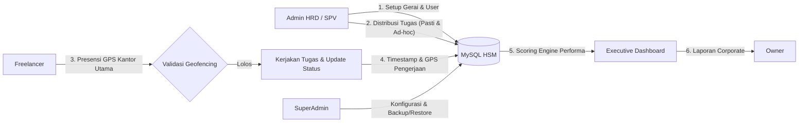
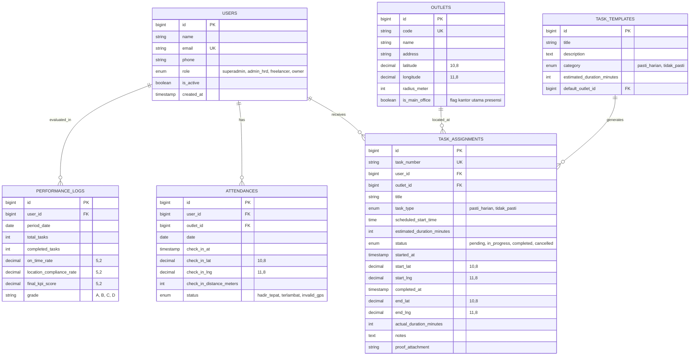

# DOKUMEN KONSEP & SPESIFIKASI SISTEM
## Aplikasi Monitoring Freelancer HSM (freelance.tikismd.id)

---

### 1. Ringkasan Eksekutif & Visi Produk

**Monitoring Freelancer HSM** adalah platform berbasis **PWA (Progressive Web Application) Mobile-First & Responsive Web** yang dirancang khusus untuk memonitor, mengukur, dan mengevaluasi produktivitas serta performa kerja karyawan lepas (freelancer) secara *real-time*, presisi, dan transparan.

Sistem ini memecahkan kendala klasik operasional lapangan (dispersed workforce), seperti ketidakpastian kehadiran, waktu pengerjaan tugas yang molor, kesulitan tracking lokasi fisik pengerjaan di berbagai gerai, hingga lambatnya rekapitulasi data performa untuk jajaran direksi/owner.

---

### 2. Matriks Hak Akses & Peran (Role-Based Access Control)

Aplikasi memiliki 4 tingkatan hak akses (*role*) dengan batasan fungsional yang terdefinisi ketat:

| Fitur / Modul | SuperAdmin | Admin HRD / SPV | Freelancer | Owner |
| :--- | :---: | :---: | :---: | :---: |
| **Manajemen Konfigurasi Sistem** | Full Akses | Tidak Ada | Tidak Ada | Tidak Ada |
| **Manajemen User (Semua Role) & Reset Password** | Full Akses | View Freelancer Only | Edit Profil Pribadi | Read-Only |
| **Backup & Restore Database** | Full Akses | Tidak Ada | Tidak Ada | Tidak Ada |
| **CRUD Master Gerai & Titik Koordinat GPS** | Full Akses | Full Akses | View Saja (Saat Bertugas) | View Saja |
| **CRUD Data Karyawan Freelancer** | Full Akses | Full Akses | Tidak Ada | View Saja |
| **Manajemen Penugasan (Pasti & Tidak Pasti)** | Full Akses | Full Akses | Read Only (Tugas Miliknya) | View Saja |
| **Presensi GPS (Check-in/Check-out)** | Tidak Ada | View & Validasi | Eksekusi Presensi | View Laporan |
| **Checklist & Update Status Pengerjaan** | View Saja | Monitoring / Override | Eksekusi Update | View Saja |
| **Kalkulasi Skor & Audit Log Performa** | Full Akses | Full Akses | View Skor Pribadi | Full Akses |
| **Executive Dashboard & Rekapitulasi Laporan** | Full Akses | Akses Laporan Lapangan | Ringkasan Pribadi | Full Akses (Ultra Lengkap) |
| **Export Dokumen Corporate (PDF / Excel)** | Full Akses | Full Akses | Download Slip/Rekap Pribadi | Full Akses |

---

### 3. Alur Kerja Utama Sistem (End-to-End Workflow)

#### Tahap 1: Setup Master Data & Geofencing (Admin HRD)
1. **Master Karyawan:** HRD mendaftarkan data karyawan freelancer (Nama, NIK, No. HP/WhatsApp, Email, Bidang/Keahlian, Tarif Pengerjaan jika berlaku).
2. **Master Gerai / Lokasi Kerja:** HRD mendata setiap gerai fisik dengan koordinat presisi (`latitude`, `longitude`) dan batas toleransi jarak (`radius_meters`, default 30–50 meter).
3. **Master Kantor Utama:** Menentukan titik koordinat kantor utama HSM sebagai lokasi wajib presensi masuk dan pulang.

#### Tahap 2: Manajemen & Distribusi Tugas
Admin HRD menyusun jadwal dan mendistribusikan tugas dengan 2 kategori:
1. **Tugas Pasti Harian (Fixed Recurring Tasks):** 
   - Tugas berulang dengan jadwal harian konsisten (contoh: *Pengecekan stok awal gerai, pembersihan area kerja, briefing harian, rekap harian*).
   - Tergenerate otomatis setiap hari pada jam tertentu sesuai template.
2. **Tugas Tidak Pasti (Dynamic / Ad-Hoc Tasks):**
   - Tugas insidental yang muncul dinamis sesuai kebutuhan hari itu (contoh: *Maintenance unit gerai X, audit gerai dadakan, pengiriman barang tambahan, penanganan kendala teknis*).
3. Setiap tugas wajib memiliki atribut:
   - **Estimasi Waktu Mulai** (*Scheduled Start Time*)
   - **Target Selesai / SLA** (*Expected Duration*)
   - **Lokasi Pengerjaan** (Gerai spesifik atau penugasan mobile)

#### Tahap 3: Presensi Harian Wajib GPS (Freelancer)
1. Karyawan freelancer membuka PWA di smartphone masing-masing.
2. Melakukan presensi hadir dengan mengaktifkan GPS:
   - Sistem membaca koordinat perangkat dan mencocokkan dengan koordinat **Kantor Utama HSM** menggunakan formula *Haversine*.
   - Jika jarak $\le$ radius batas (contoh 50m), presensi berhasil.
   - Jika di luar radius, presensi tertolak dengan notifikasi selisih jarak.
3. Karyawan tidak dapat memulai proses tugas jika belum melakukan presensi masuk.

#### Tahap 4: Pelaksanaan & Update Status Tugas (Freelancer)
Karyawan mengakses menu daftar tugas harian mereka dengan siklus status 3 tahap:
1. **Belum Diproses (`pending`)**: Tugas sudah masuk daftar antrean kerja.
2. **Sedang Diproses (`in_progress`)**:
   - Karyawan menekan tombol *Mulai Kerjakan*.
   - Sistem mengunci timestamp waktu mulai (`started_at`) dan mencatat koordinat GPS saat tombol ditekan (`start_latitude`, `start_longitude`).
3. **Selesai Diproses (`completed`)**:
   - Karyawan menekan tombol *Selesai*.
   - Karyawan melampirkan catatan pengerjaan dan opsional foto bukti.
   - Sistem mengunci timestamp selesai (`completed_at`) dan koordinat GPS akhir (`end_latitude`, `end_longitude`).

#### Tahap 5: Logging, Engine Kalkulasi, & Audit Trail
1. Sistem menghitung durasi aktual: $\text{Durasi Aktual} = \text{Waktu Selesai} - \text{Waktu Mulai}$.
2. Sistem membandingkan durasi aktual dengan target SLA tugas.
3. Sistem mendeteksi kesesuaian lokasi pengerjaan terhadap gerai yang ditugaskan.
4. Data dikirimkan ke mesin kalkulasi KPI untuk memperbarui rating harian karyawan.

#### Tahap 6: Monitoring, Dashboard Eksekutif & Laporan (Owner & HRD)
1. **Owner** membuka dashboard eksekutif untuk melihat performa real-time:
   - Rasio penyelesaian tugas harian (Completion Rate).
   - Freelancer dengan performa tertinggi (Top Performers) & paling banyak terlambat.
   - Peta sebaran penugasan gerai secara live.
   - Durasi rata-rata pengerjaan per gerai / per jenis tugas.
2. Laporan dapat diekspor langsung ke format dokumen korporat (PDF/Excel) berstandar resmi.

#### Tahap 7: Maintenance & Tata Kelola Keamanan (SuperAdmin)
1. SuperAdmin memantau log aktivitas seluruh user.
2. Fasilitas *One-Click Password Reset* bagi karyawan/admin yang terkendala login.
3. Fitur backup berkala (*Automated Scheduled Backup*) & manual backup serta restore database MySQL.

---

### 4. Algoritma & Formula Penilaian Kinerja (KPI Engine)

Untuk menghasilkan evaluasi yang obyektif, performa freelancer dihitung berdasarkan formula komposit berbobot (*Weighted Performance Index*):

$$\text{Skor Kinerja (0 - 100)} = (W_1 \times S_{\text{selesai}}) + (W_2 \times S_{\text{waktu}}) + (W_3 \times S_{\text{lokasi}}) + (W_4 \times S_{\text{kehadiran}})$$

#### Komponen Bobot:
1. **Penyelesaian Tugas ($S_{\text{selesai}}$, Bobot 35%):**
   $$\frac{\text{Jumlah Tugas Selesai}}{\text{Total Tugas Ditugaskan}} \times 100$$
2. **Ketepatan Waktu / SLA ($S_{\text{waktu}}$, Bobot 30%):**
   - Tepat waktu $\le \text{Target SLA} \rightarrow 100$ poin.
   - Terlambat $\le 15$ menit $\rightarrow 80$ poin.
   - Terlambat $> 15$ menit $\rightarrow \max(0, 100 - (2 \times \text{Menit Keterlambatan}))$ poin.
3. **Akurasi Lokasi ($S_{\text{lokasi}}$, Bobot 20%):**
   - Validasi apakah eksekusi pengerjaan dilakukan di radius gerai yang benar.
4. **Kedisiplinan Presensi Kantor ($S_{\text{kehadiran}}$, Bobot 15%):**
   - Presensi tepat waktu di kantor utama sebelum jam kerja dimulai.

#### Kategori Predikat Performa:
- **90.00 – 100.00**: *Outstanding / Sangat Memuaskan (Grade A)*
- **80.00 – 89.99**: *High Performer / Memuaskan (Grade B)*
- **70.00 – 79.99**: *Standard / Cukup (Grade C)*
- **< 70.00**: *Underperformer / Butuh Evaluasi (Grade D)*

---

### 5. Konsep Desain UI/UX & Antarmuka

#### 5.1. Sistem Warna & Tema Visual
- **Nuansa Utama:** *Deep Navy Corporate Luxury* dengan aksen *Vibrant Energy Orange*.
  - **Background Utama:** `#08101C` (Midnight Navy Depth)
  - **Surface Glass Container:** `rgba(14, 30, 54, 0.70)` dengan `backdrop-filter: blur(16px)`
  - **Border Stroke:** `rgba(255, 255, 255, 0.12)` dengan efek *subtle light glow*
  - **Primary Accent:** `#FF6500` (Energetic Corporate Orange)
  - **Secondary Accent:** `#FF8800` & `#00A3FF` (Cyan Glow for secondary badges)
  - **Text Typography:** `#FFFFFF` (Heading) & `#B8C9E1` (Body Paragraphs)

#### 5.2. PWA Mobile-First: Animated "Water Bubble" Bottom Dock
- Mengadopsi motion interaktif ala Figma Prototype level tinggi.
- Dock navigasi bawah berbentuk kapsul mengambang (*floating pill*) dengan efek *frosted glass*.
- **Efek Buble Air (Water/Fluid Motion):**
  - Saat tab menu disentuh, indikator aktif bergerak seperti tetesan cairan kental (*liquid morphing*) dengan kurva *spring bounce* (`cubic-bezier(0.34, 1.56, 0.64, 1)`).
  - Terdapat efek riak lembut (*subtle water ripple*) dan pendaran cahaya oranye pada ikon yang aktif.
  - Sangat ergonomis untuk penggunaan satu tangan di area jempol (*thumb zone*).

#### 5.3. Tablet & Desktop: Luxury Glassmorphism Sidebar
- Navigasi samping vertikal dengan panel kaca semi-transparan elegan.
- *Collapsible drawer* dengan transisi halus *ease-in-out*.
- Menu item dilengkapi micro-interaction: saat di-hover, muncul pendaran gradient oranye-navy lembut (*ambient glow*), bukan sekadar blok warna kaku.
- Integrasi status koneksi PWA (Online/Offline indicator) di sudut bawah.

#### 5.4. Notifikasi & Interaksi Data
- **SweetAlert2 Custom Theme:** Modal konfirmasi bergaya Glassmorphism gelap dengan tombol oranye menyala dan efek animasi pental halus.
- **Chart.js Modern:** Grafik tren performa menggunakan *gradient fill*, *curved line smoothing*, *custom glass tooltips*, dan palet warna selaras.

---

### 6. Arsitektur Teknis & Struktur Database

#### 6.1. Tech Stack
- **Backend:** Laravel 11.x (PHP 8.2+) dengan arsitektur Repository / Service Pattern.
- **Frontend / UI:** Blade + Tailwind CSS (v3/v4) + Alpine.js (untuk animasi liquid fluid) + Vite.
- **PWA Engine:** Service Worker, Manifest JSON, Offline Support Caching, Background Sync untuk submit tugas saat sinyal lemah.
- **Database:** MySQL 8.0 (InnoDB, Foreign Key Integrity, Spatial Indexing).
- **Libraries Tambahan:**
  - `leaflet.js` & `leaflet-routing-machine` untuk peta interaktif & geofencing circle.
  - `chart.js` + plugin datalabels untuk visualisasi analitik Owner.
  - `sweetalert2` untuk notifikasi & konfirmasi aksi.
  - `dompdf` / `barryvdh/laravel-dompdf` & `maatwebsite/excel` untuk ekspor laporan.

#### 6.2. Struktur Tabel Utama (MySQL Entity)

---

### 7. Format Standar Laporan Corporate Professional

Semua laporan yang dapat dilihat oleh Owner dan diekspor oleh HRD/SuperAdmin dirancang dengan estetika korporat formal (*clean corporate layout*):

1. **Header Standar Korporat:**
   - Logo Perusahaan HSM & Identitas Legal.
   - Judul Laporan: *Laporan Evaluasi Performa Freelancer Periode [Tanggal]*.
   - Metadata Dokumen: No. Dokumen, Tanggal Cetak, Diterbitkan Oleh, Klasifikasi: *Confidential / Internal Use Only*.
2. **Executive Summary Cards (Ringkasan Tingkat Tinggi):**
   - Total Jam Pengerjaan, Rata-rata Skor KPI Tim, Persentase On-Time Delivery, Gerai dengan Aktivitas Tertinggi.
3. **Tabel Data Rinci & Indikator Warna Status:**
   - Format tabel zebra-striping rapi dengan font sans-serif monospaced untuk angka durasi.
   - Status badge dengan warna yang jelas (Hijau = Selesai Tepat Waktu, Kuning = Keterlambatan Ringan, Merah = Anomali Lokasi/Terlambat Jauh).
4. **Catatan Analitik & Rekomendasi:**
   - Kolom temuan otomatis (contoh: *Freelancer A memiliki kepatuhan lokasi 100% dan efisiensi waktu 115% di atas rata-rata*).
5. **Lembar Pengesahan Resmi:**
   - Kolom tanda tangan digital / verifikasi (*Dipersiapkan oleh Supervisor, Diperiksa oleh HRD Manager, Disetujui oleh Direktur / Owner*).

---

### 8. Fitur Khusus SuperAdmin & Keamanan Data

1. **User Identity & Credential Recovery:**
   - Fitur reset password instan dengan generate password acak aman yang dapat langsung dikirim via template pesan WhatsApp / email.
   - Session revocation (dapat menghentikan paksa sesi login freelancer dari jarak jauh).
2. **Database Management & Recovery:**
   - **One-Click Backup:** Membuat arsip kompresi `.sql.gz` dari seluruh database MySQL langsung dari panel admin.
   - **Backup Scheduler:** Cron job otomatis setiap pukul 00:00 WIB yang tersimpan di storage lokal maupun cloud backup.
   - **Restore Assistant:** Fitur unggah file backup dengan validasi skema sebelum melakukan restorasi untuk mencegah *data corruption*.
3. **Audit Trail & Anti-Fraud GPS:**
   - Pencegahan *Fake GPS / Mock Location* di level PWA dengan memeriksa akurasi hardware API HTML5 Geolocation (`accuracy` threshold $\le 20$ meter).

---

### 9. Rencana Tahapan Eksekusi (Implementation Roadmap)

| Tahap | Fokus Pekerjaan | Deliverable |
| :---: | :--- | :--- |
| **Fase 1** | Inisialisasi Proyek & Basis Data | Instalasi Laravel 11, setting MySQL, migrasi skema tabel, Seeder 4 role dasar |
| **Fase 2** | UI/UX Shell & Design System | Setup Tailwind CSS, Glassmorphism components, Liquid Water Bubble Bottom Nav, Luxury Sidebar |
| **Fase 3** | Modul Master Data & Presensi GPS | CRUD Karyawan, CRUD Gerai, Modul Geofencing Presensi GPS kantor utama |
| **Fase 4** | Modul Penugasan & Tracking Status | Manajemen Tugas Pasti vs Tidak Pasti, Checklist 3-status pengerjaan freelancer |
| **Fase 5** | Scoring Engine & Laporan Corporate | Formula kalkulasi KPI harian, Export PDF/Excel corporate, Integrasi Chart.js |
| **Fase 6** | Dashboard Owner & SuperAdmin Panel | Executive Dashboard ultra-lengkap, User management, Backup/Restore database |
| **Fase 7** | PWA Hardening & Testing | Konfigurasi Manifest, Service Worker offline caching, Mock Location detection, UAT |

---

> [!NOTE]
> Seluruh detail teknis dan alur fungsional pada dokumen ini siap dijadikan acuan utama dalam proses *development* sistem **Monitoring Freelancer HSM**. Silakan review dan berikan masukan bila ada komponen khusus yang ingin disesuaikan.
